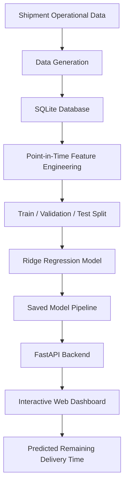

# LogiTrack AI — Shipment ETA Prediction System

An AI-powered Shipment Estimated Time of Arrival (ETA) Prediction System built using Machine Learning, Python, FastAPI, and an interactive web dashboard.

LogiTrack AI demonstrates how operational shipment information can be transformed into point-in-time features and used to estimate the remaining delivery time through a trained Machine Learning model.

---

## Dashboard Preview

### Overview


### ETA Prediction


### Prediction Results


### Model Information


---

## Key Features

- **Shipment ETA Prediction:** Estimates remaining delivery time using a trained Ridge Regression model.
- **Interactive Dashboard:** Professional dashboard for entering shipment information and viewing predictions.
- **40 Model Predictors:** Uses shipment, carrier, route, tracking, weather, and facility queue information.
- **Point-in-Time Feature Engineering:** Ensures predictors use information available at the prediction timestamp.
- **Synthetic Dataset Generation:** Supports realistic shipment scenarios with operational disruptions.
- **FastAPI Backend:** Provides REST API endpoints for model inference.
- **Model Evaluation:** Includes chronological train, validation, and test splits.
- **Automated Testing:** Tests for feature leakage, data validation, model behavior, and API functionality.

---

## System Architecture



---

## Technology Stack

| Category | Technologies |
|---|---|
| Programming Language | Python |
| Machine Learning | Scikit-learn |
| Model | Ridge Regression |
| Data Processing | Pandas, NumPy |
| Database | SQLite |
| Backend | FastAPI |
| API Server | Uvicorn |
| Frontend | HTML, CSS, JavaScript |
| Testing | Pytest, HTTPX |
| Version Control | Git, GitHub |

---

## Dataset

The `realistic_v2` dataset is synthetically generated for development and evaluation.

| Dataset Attribute | Value |
|---|---:|
| Shipments | 50,000 |
| Tracking Events | 300,000 |
| Facilities | 100 |
| Model Predictors | 40 |
| Training Samples | 35,000 |
| Validation Samples | 7,500 |
| Test Samples | 7,500 |

The dataset includes shipment details, carrier information, route plans, tracking events, weather forecasts, facility queues, and delivery outcomes.

### Data Leakage Prevention

The feature engineering pipeline follows point-in-time availability rules:

- Weather information must have been available by the prediction timestamp.
- Queue observations must have been ingested before the prediction cutoff.
- Carrier reliability uses only historical delivery information.
- Route-plan versions are selected based on when they became known.
- Future outcomes and target variables are excluded from model predictors.

---

## Model Performance

**Selected Model: Ridge Regression**

The model was selected using validation Mean Absolute Error (MAE), followed by a final evaluation on the held-out test set.

| Evaluation Metric | Test Result |
|---|---:|
| MAE | 1.0091 hours |
| RMSE | 1.4125 hours |
| R² Score | 0.9866 |

### Understanding the Metrics

- **MAE:** Average absolute difference between predicted and actual remaining delivery time.
- **RMSE:** Measures prediction errors while penalizing larger errors more heavily.
- **R² Score:** Indicates how much variation in the test targets is explained by the model.

**Important:** These results are based entirely on synthetic data. They do not establish real-world predictive accuracy or production readiness.

---

## Project Structure

```text
LogiTrack-AI/
│
├── dashboard/
│   ├── assets/
│   │   ├── dashboard.css
│   │   └── dashboard.js
│   └── index.html
│
├── data/
│   └── .gitkeep
│
├── docs/
│   ├── Screenshots/
│   ├── api_readme.md
│   ├── data_dictionary.md
│   ├── features.md
│   ├── generation.md
│   └── schema.md
│
├── models/
│   ├── eta_v1/
│   └── realistic_v2/
│
├── reports/
│   ├── eda/
│   ├── model_analysis/
│   ├── modeling/
│   └── realistic_v2/
│
├── scripts/
│   └── analyze_eta_errors.py
│
├── src/
│   ├── api/
│   ├── business_logic/
│   ├── database/
│   ├── features/
│   ├── generator/
│   ├── prediction/
│   └── validation/
│
├── tests/
├── .gitignore
├── README.md
└── requirements.txt
```

---

## Installation and Setup

### 1. Clone the repository

```bash
git clone https://github.com/MalikAIXplorer/LogiTrack-AI.git
```

### 2. Navigate to the project directory

```bash
cd LogiTrack-AI
```

### 3. Create a virtual environment

```bash
python -m venv venv
```

Activate it on Windows:

```bash
venv\Scripts\activate
```

### 4. Install dependencies

```bash
pip install -r requirements.txt
```

### 5. Start the FastAPI application

```bash
python -m uvicorn src.api.app:app --host 127.0.0.1 --port 8000
```

### 6. Open the application

| Interface | URL |
|---|---|
| Dashboard | http://127.0.0.1:8000/dashboard |
| API Documentation | http://127.0.0.1:8000/docs |
| Health Check | http://127.0.0.1:8000/health |
| Model Information | http://127.0.0.1:8000/model-info |

The dashboard and API use the saved model artifact. The required model and dataset artifacts must be available locally.

---

## Running Tests

Run the complete test suite:

```bash
python -m pytest -q
```

The tests cover:

- Database schema and relationships.
- Dataset generation and validation.
- Point-in-time feature engineering.
- Future-information leakage prevention.
- Model training and evaluation.
- API prediction and input validation.
- Dashboard and static asset delivery.

---

## Future Improvements

- Integration with real-time shipment tracking APIs.
- Model evaluation using representative real-world logistics data.
- Advanced regression models and comparative evaluation.
- Containerization using Docker.
- Cloud deployment and monitoring.
- Model drift detection and periodic retraining.

---

## Limitations

LogiTrack AI is an educational and portfolio demonstration project.

The dataset is synthetic, and the trained model has not been validated against real operational shipment data. Predictions should not be treated as guaranteed delivery times or used as production logistics decisions without further validation.

---

## Author

**Malik Junaid Ur Rahman**

Computer Science Graduate | AI & Machine Learning

- GitHub: [@MalikAIXplorer](https://github.com/MalikAIXplorer)
- LinkedIn: [Malik Junaid Ur Rahman](https://www.linkedin.com/in/malik-junaid-ur-rahman-116539290/)

---

*Built to explore Machine Learning, point-in-time feature engineering, and practical AI-powered logistics applications.*
