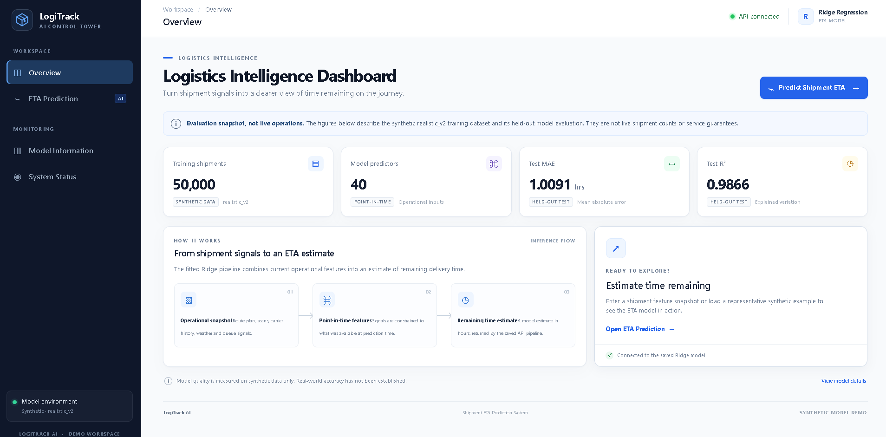
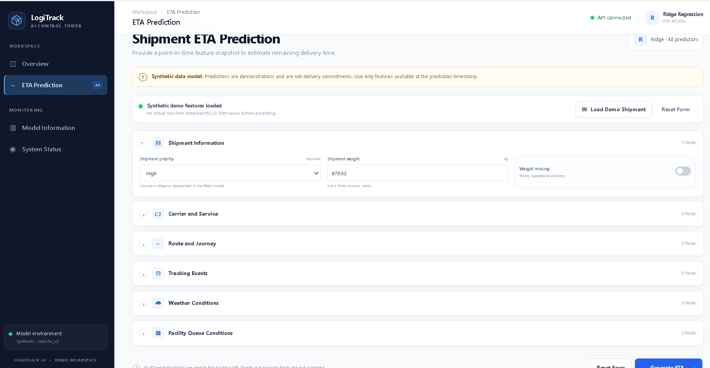
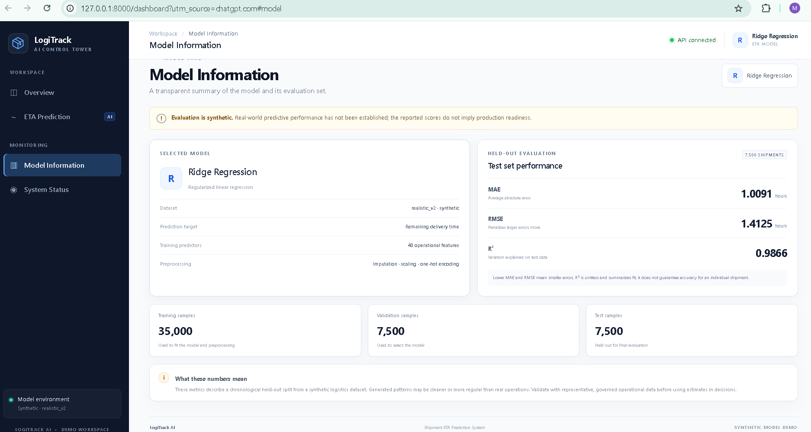
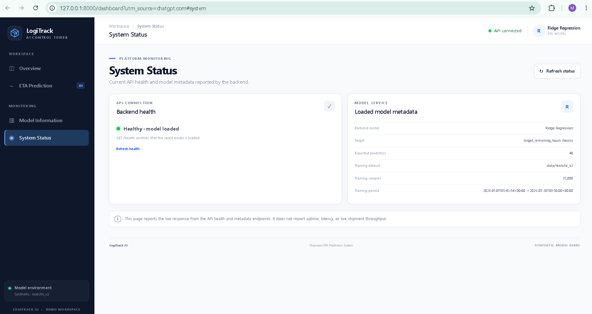

# LogiTrack AI — Shipment ETA Prediction System

**An AI-powered shipment delivery time prediction platform built with Machine Learning, FastAPI, and an interactive enterprise-style dashboard.**

LogiTrack AI uses a trained Ridge Regression pipeline to estimate the remaining delivery time of shipments from operational, carrier, route, tracking, weather, and facility queue information.

The project combines machine learning inference with a REST API and a responsive logistics intelligence dashboard.

---

## Dashboard Preview

### 1. Overview Dashboard


### 2. Shipment ETA Prediction


### 3. Model Information


### 4. System Status


---

## Key Features

- **Machine Learning Inference:** Predict remaining shipment delivery time using a saved Ridge Regression pipeline.
- **FastAPI Backend:** RESTful API for predictions, model metadata, and health monitoring.
- **Interactive Dashboard:** Responsive interface for shipment inputs and prediction results.
- **40 Operational Predictors:** Supports shipment, carrier, route, tracking, weather, and facility queue features.
- **Input Validation:** Rejects missing, invalid, and unsupported prediction fields.
- **Model Monitoring:** Displays actual API health and model metadata.
- **Demo Shipment:** Load a representative synthetic shipment for testing.
- **Automated Tests:** API and application tests for core functionality.

## Technology Stack

| Category | Technologies |
|---|---|
| Programming | Python, JavaScript |
| Machine Learning | Scikit-learn, Ridge Regression |
| Backend | FastAPI, Uvicorn |
| Frontend | HTML, CSS, JavaScript |
| Data Processing | Pandas, NumPy |
| Model Storage | Joblib |
| Testing | Pytest, HTTPX |
| Version Control | Git, GitHub |

## System Architecture

```text
Shipment Feature Inputs
          |
          v
Interactive Web Dashboard
          |
          v
FastAPI REST API
          |
          v
Input Validation
          |
          v
Saved Ridge Regression Pipeline
          |
          v
Predicted Remaining Delivery Time
          |
          v
Dashboard Result
```

## Model Performance

The project uses the `realistic_v2` synthetic dataset.

| Metric | Result |
|---|---:|
| Model | Ridge Regression |
| Training Samples | 35,000 |
| Validation Samples | 7,500 |
| Test Samples | 7,500 |
| Model Predictors | 40 |
| Test MAE | 1.0091 hours |
| Test RMSE | 1.4125 hours |
| Test R² | 0.9866 |

**Important:** These metrics are based on synthetic data. Real-world predictive accuracy has not been established. Predictions are demonstration estimates, not delivery guarantees.

## Getting Started

### Prerequisites

- Python 3.12
- Git
- pip

### 1. Clone the repository

```bash
git clone https://github.com/MalikAIXplorer/LogiTrack-AI.git
cd LogiTrack-AI
```

### 2. Create a virtual environment

```bash
python -m venv .venv
```

Activate it on Windows PowerShell:

```powershell
.\.venv\Scripts\Activate.ps1
```

### 3. Install dependencies

```bash
python -m pip install -r requirements.txt
```

### 4. Start the API and dashboard

```bash
python -m uvicorn src.api.app:app --host 127.0.0.1 --port 8000
```

Open the dashboard:

http://127.0.0.1:8000/dashboard

API documentation:

http://127.0.0.1:8000/docs

## API Endpoints

| Method | Endpoint | Description |
|---|---|---|
| GET | `/` | API information |
| GET | `/health` | API and model health |
| GET | `/model-info` | Model metadata |
| POST | `/predict` | Shipment ETA prediction |
| GET | `/dashboard` | Interactive web dashboard |

## Running Tests

Run the test suite from the project root:

```bash
python -m pytest -q
```

## Project Structure

```text
LogiTrack-AI/
│
├── dashboard/
│   ├── assets/
│   │   ├── dashboard.css
│   │   └── dashboard.js
│   └── index.html
│
├── data/
│
├── docs/
│   ├── Screenshots/
│   ├── api_readme.md
│   ├── data_dictionary.md
│   ├── features.md
│   ├── generation.md
│   └── schema.md
│
├── models/
│   └── realistic_v2/
│
├── reports/
│
├── scripts/
│
├── src/
│   ├── api/
│   ├── business_logic/
│   ├── database/
│   ├── features/
│   ├── generator/
│   ├── prediction/
│   └── validation/
│
├── tests/
├── requirements.txt
└── README.md
```

## Limitations

- The current model is trained and evaluated using synthetic shipment data.
- Real-world performance has not yet been validated.
- Predictions depend on the quality and availability of input features.
- The application is a demonstration system and is not intended for live logistics decisions without further validation.

## Future Enhancements

- Integration with real-time carrier tracking APIs.
- Live shipment monitoring and analytics.
- Advanced model comparison and experimentation.
- Cloud deployment and containerization.
- Production monitoring and model drift detection.
- Role-based authentication and user management.

---

## Author

**Malik Junaid Ur Rahman**

Computer Science Graduate | AI & Machine Learning

- GitHub: https://github.com/MalikAIXplorer
- LinkedIn: https://www.linkedin.com/in/malik-junaid-ur-rahman-116539290/

---

*LogiTrack AI — Turning shipment signals into delivery intelligence.*
