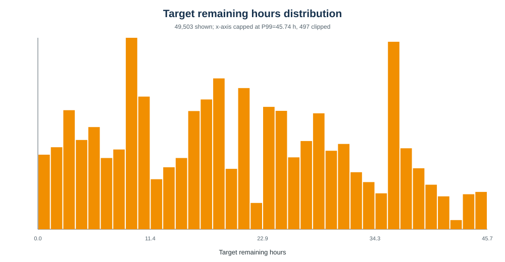
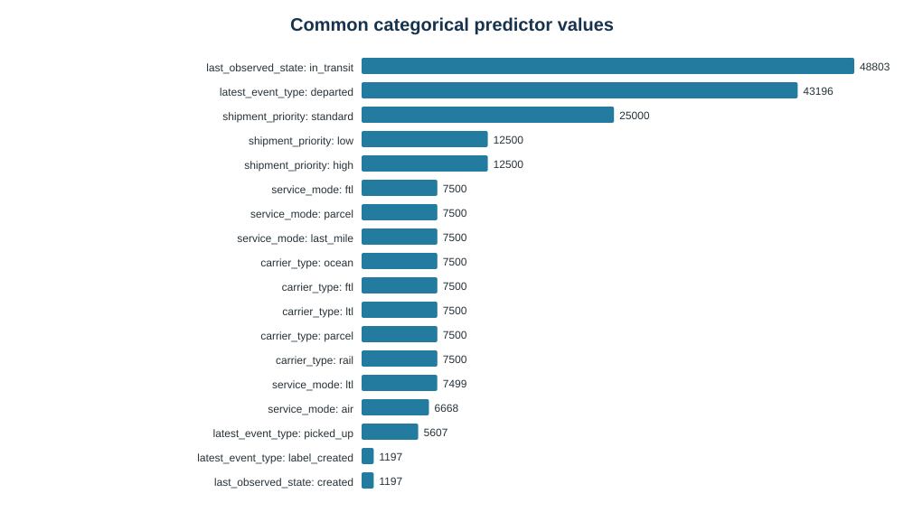
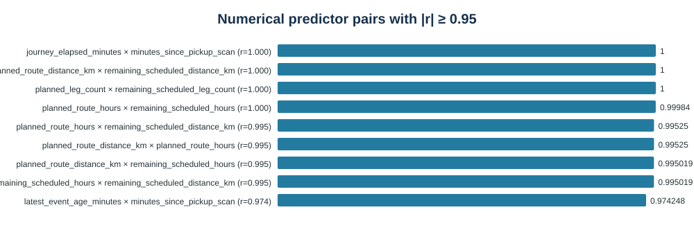

# LogiTrack AI full feature EDA

Generated 2026-11-08 08:15 UTC. Source files were read only.

## Summary

- Features: 50,000 rows × 35 columns. Targets: 50,000 rows × 5 columns. The feature file has 32 predictor columns plus 3 metadata identifiers.
- Matching identifiers: 50,000 `(shipment_id, eta_id)` pairs; unmatched feature/target keys 0/0; duplicate pairs 0/0.
- Unique shipments: 50,000; repeated shipment IDs: 0. There is one ETA snapshot per shipment in this dataset.
- Eligible regression targets: 50,000 of 50,000. Separate ground truth: 37,500 on time and 12,500 delayed.

## Schemas and key matching

`features.csv` contains 3 metadata fields and 32 predictors. `targets.csv` contains 2 matching IDs plus `target_delivery_time`, `target_remaining_hours`, and `target_eligible`. The feature dictionary has 38 documented fields.
Feature and target rows match one-to-one by both shipment and ETA snapshot IDs. Ground truth was read separately only to summarize on-time/delayed labels; it was not joined into the feature matrix.

## Target remaining hours

Statistics use eligible rows with a nonmissing target. Standard deviation is sample standard deviation. Tukey outliers are values beyond 1.5×IQR fences; these are review candidates, not automatic errors.

| Statistic | Hours |
|---|---:|
| Count | 50,000 |
| Mean | 21.652 |
| Median | 20.687 |
| Sample standard deviation | 11.656 |
| Minimum | 1.995 |
| Maximum | 47.660 |
| P1 | 2.678 |
| P5 | 4.242 |
| P10 | 6.080 |
| P25 | 11.543 |
| P50 | 20.687 |
| P75 | 30.704 |
| P90 | 37.420 |
| P95 | 40.510 |
| P99 | 45.743 |
| Skewness | 0.197 |
| IQR | 19.161 |
| Tukey outliers | 0 (0.00%) |

Tukey fences: -17.198 to 59.445 hours. The histogram caps its x-axis at P99 for readability; the full maximum is listed above.

## Eligibility and delivery labels

`target_eligible` means delivery happened after prediction and a remaining-hours target can be calculated. It is not the on-time flag. The separate ground-truth label counts are:

| Label | Rows | Share |
|---|---:|---:|
| On time | 37,500 | 75.00% |
| Delayed | 12,500 | 25.00% |
| Eligible target=1 | 50,000 | 100.00% |
| Eligible target=0 | 0 | 0.00% |
Ground-truth key matches: 50,000; invalid binary labels: 0; on_time+delayed not equal to one: 0.

## Missing values for every predictor

A missing flag distinguishes “not observed” from a measured zero where available. Missing `latest_event_leg_number` means no event-leg reference was available. Missing `minutes_since_pickup_scan` means no eligible pickup scan was seen; `pickup_scan_seen` provides context. Other predictors have no missing values in this file.

| Predictor | Missing | Rate | Meaning |
|---|---:|---:|---|
| `service_mode` | 0 | 0.00% | No missing values observed. |
| `service_target_transit_hours` | 0 | 0.00% | No missing values observed. |
| `service_reference_missing` | 0 | 0.00% | No missing values observed. |
| `carrier_type` | 0 | 0.00% | No missing values observed. |
| `carrier_reference_missing` | 0 | 0.00% | No missing values observed. |
| `shipment_priority` | 0 | 0.00% | No missing values observed. |
| `shipment_weight_kg` | 0 | 0.00% | No missing values observed. |
| `weight_missing` | 0 | 0.00% | No missing values observed. |
| `journey_elapsed_minutes` | 0 | 0.00% | No missing values observed. |
| `planned_route_distance_km` | 0 | 0.00% | No missing values observed. |
| `planned_route_hours` | 0 | 0.00% | No missing values observed. |
| `planned_leg_count` | 0 | 0.00% | No missing values observed. |
| `remaining_scheduled_leg_count` | 0 | 0.00% | No missing values observed. |
| `remaining_scheduled_hours` | 0 | 0.00% | No missing values observed. |
| `remaining_scheduled_distance_km` | 0 | 0.00% | No missing values observed. |
| `eligible_event_count` | 0 | 0.00% | No missing values observed. |
| `latest_event_type` | 0 | 0.00% | No missing values observed. |
| `latest_event_missing` | 0 | 0.00% | No missing values observed. |
| `last_observed_state` | 0 | 0.00% | No missing values observed. |
| `latest_event_age_minutes` | 0 | 0.00% | No missing values observed. |
| `latest_event_leg_number` | 1,197 | 2.39% | No eligible event leg was available; use the null with event-state context. |
| `pickup_scan_seen` | 0 | 0.00% | No missing values observed. |
| `minutes_since_pickup_scan` | 2,605 | 5.21% | No pickup scan was available by prediction; `pickup_scan_seen` distinguishes this from zero minutes. |
| `weather_observation_count` | 0 | 0.00% | No missing values observed. |
| `active_weather_disruption_count` | 0 | 0.00% | No missing values observed. |
| `max_active_weather_severity` | 0 | 0.00% | No missing values observed. |
| `weather_observation_missing` | 0 | 0.00% | No missing values observed. |
| `queue_observation_count` | 0 | 0.00% | No missing values observed. |
| `max_observed_queue_length` | 0 | 0.00% | No missing values observed. |
| `mean_observed_wait_minutes` | 0 | 0.00% | No missing values observed. |
| `queue_wait_missing` | 0 | 0.00% | No missing values observed. |
| `queue_observation_missing` | 0 | 0.00% | No missing values observed. |

## Categorical feature distributions

One-hot encode these categories inside the training pipeline, fitted on training data only.

### `service_mode`

| Value | Rows | Share |
|---|---:|---:|
| ftl | 7,500 | 15.00% |
| parcel | 7,500 | 15.00% |
| last_mile | 7,500 | 15.00% |
| ltl | 7,499 | 15.00% |
| air | 6,668 | 13.34% |
| ocean | 6,667 | 13.33% |
| rail | 6,666 | 13.33% |

### `carrier_type`

| Value | Rows | Share |
|---|---:|---:|
| ocean | 7,500 | 15.00% |
| ftl | 7,500 | 15.00% |
| ltl | 7,500 | 15.00% |
| parcel | 7,500 | 15.00% |
| rail | 7,500 | 15.00% |
| air | 7,500 | 15.00% |
| last_mile | 5,000 | 10.00% |

### `shipment_priority`

| Value | Rows | Share |
|---|---:|---:|
| standard | 25,000 | 50.00% |
| low | 12,500 | 25.00% |
| high | 12,500 | 25.00% |

### `latest_event_type`

| Value | Rows | Share |
|---|---:|---:|
| departed | 43,196 | 86.39% |
| picked_up | 5,607 | 11.21% |
| label_created | 1,197 | 2.39% |

### `last_observed_state`

| Value | Rows | Share |
|---|---:|---:|
| in_transit | 48,803 | 97.61% |
| created | 1,197 | 2.39% |

## Numerical feature ranges

| Predictor | Min | P01 | Median | Mean | SD | P99 | Max | Missing | Unique |
|---|---:|---:|---:|---:|---:|---:|---:|---:|---:|
| `service_target_transit_hours` | 32.000 | 32.000 | 56.000 | 55.600 | 16.227 | 80.000 | 80.000 | 0 | 7 |
| `service_reference_missing` | 0.000 | 0.000 | 0.000 | 0.000 | 0.000 | 0.000 | 0.000 | 0 | 1 |
| `carrier_reference_missing` | 0.000 | 0.000 | 0.000 | 0.000 | 0.000 | 0.000 | 0.000 | 0 | 1 |
| `shipment_weight_kg` | 0.200 | 9.280 | 451.055 | 450.564 | 260.525 | 890.660 | 899.980 | 0 | 38,262 |
| `weight_missing` | 0.000 | 0.000 | 0.000 | 0.000 | 0.000 | 0.000 | 0.000 | 0 | 1 |
| `journey_elapsed_minutes` | 294.900 | 294.900 | 360.000 | 355.276 | 14.250 | 360.000 | 360.000 | 0 | 11 |
| `planned_route_distance_km` | 230.470 | 230.470 | 1,613.375 | 1,587.191 | 850.613 | 3,241.000 | 3,241.000 | 0 | 59 |
| `planned_route_hours` | 3.660 | 3.660 | 21.170 | 22.345 | 11.610 | 46.190 | 47.610 | 0 | 79 |
| `planned_leg_count` | 1.000 | 1.000 | 2.000 | 2.000 | 0.817 | 3.000 | 3.000 | 0 | 3 |
| `remaining_scheduled_leg_count` | 1.000 | 1.000 | 2.000 | 2.000 | 0.817 | 3.000 | 3.000 | 0 | 3 |
| `remaining_scheduled_hours` | 2.745 | 2.745 | 19.170 | 20.423 | 11.493 | 44.190 | 45.610 | 0 | 79 |
| `remaining_scheduled_distance_km` | 230.470 | 230.470 | 1,613.375 | 1,587.191 | 850.613 | 3,241.000 | 3,241.000 | 0 | 59 |
| `eligible_event_count` | 1.000 | 1.000 | 3.000 | 2.875 | 0.531 | 4.000 | 4.000 | 0 | 4 |
| `latest_event_missing` | 0.000 | 0.000 | 0.000 | 0.000 | 0.000 | 0.000 | 0.000 | 0 | 1 |
| `latest_event_age_minutes` | 44.900 | 44.900 | 110.000 | 112.382 | 39.709 | 360.000 | 360.000 | 0 | 33 |
| `latest_event_leg_number` | 1.000 | 1.000 | 1.000 | 1.000 | 0.000 | 1.000 | 1.000 | 1,197 | 1 |
| `pickup_scan_seen` | 0.000 | 0.000 | 1.000 | 0.948 | 0.222 | 1.000 | 1.000 | 0 | 2 |
| `minutes_since_pickup_scan` | 54.900 | 54.900 | 120.000 | 115.471 | 13.949 | 120.000 | 120.000 | 2,605 | 11 |
| `weather_observation_count` | 0.000 | 0.000 | 2.000 | 2.976 | 2.930 | 12.000 | 18.000 | 0 | 19 |
| `active_weather_disruption_count` | 0.000 | 0.000 | 0.000 | 0.020 | 0.143 | 1.000 | 2.000 | 0 | 3 |
| `max_active_weather_severity` | 0.000 | 0.000 | 0.000 | 0.063 | 0.475 | 3.000 | 5.000 | 0 | 6 |
| `weather_observation_missing` | 0.000 | 0.000 | 0.000 | 0.214 | 0.410 | 1.000 | 1.000 | 0 | 2 |
| `queue_observation_count` | 1.000 | 1.000 | 2.000 | 1.999 | 0.817 | 3.000 | 3.000 | 0 | 3 |
| `max_observed_queue_length` | 5.000 | 7.000 | 70.000 | 65.197 | 25.035 | 99.000 | 99.000 | 0 | 95 |
| `mean_observed_wait_minutes` | 12.000 | 16.800 | 124.800 | 124.805 | 51.468 | 232.800 | 237.600 | 0 | 364 |
| `queue_wait_missing` | 0.000 | 0.000 | 0.000 | 0.000 | 0.000 | 0.000 | 0.000 | 0 | 1 |
| `queue_observation_missing` | 0.000 | 0.000 | 0.000 | 0.000 | 0.000 | 0.000 | 0.000 | 0 | 1 |

## Constant columns, correlations, and suspicious values

Constant predictors: `service_reference_missing`, `carrier_reference_missing`, `weight_missing`, `latest_event_missing`, `queue_wait_missing`, `queue_observation_missing`. They have no variation in this dataset; review whether to drop them during preprocessing.
Numerical feature pairs with |Pearson r| ≥ 0.95: 9. High correlation can mean redundant information, not an error.

| Feature A | Feature B | Pearson r |
|---|---|---:|
| `journey_elapsed_minutes` | `minutes_since_pickup_scan` | 1.0000 |
| `planned_route_distance_km` | `remaining_scheduled_distance_km` | 1.0000 |
| `planned_leg_count` | `remaining_scheduled_leg_count` | 1.0000 |
| `planned_route_hours` | `remaining_scheduled_hours` | 0.9998 |
| `planned_route_hours` | `remaining_scheduled_distance_km` | 0.9952 |
| `planned_route_distance_km` | `planned_route_hours` | 0.9952 |
| `planned_route_distance_km` | `remaining_scheduled_hours` | 0.9950 |
| `remaining_scheduled_hours` | `remaining_scheduled_distance_km` | 0.9950 |
| `latest_event_age_minutes` | `minutes_since_pickup_scan` | 0.9742 |

Range checks tested nonnegative time/count/distance/wait measures, positive service time/weight/leg count, weather severity 0–5, and binary flags 0/1.

| Check | Violations |
|---|---:|
| `service_target_transit_hours` | 0 |
| `shipment_weight_kg` | 0 |
| `journey_elapsed_minutes` | 0 |
| `planned_route_distance_km` | 0 |
| `planned_route_hours` | 0 |
| `planned_leg_count` | 0 |
| `remaining_scheduled_leg_count` | 0 |
| `remaining_scheduled_hours` | 0 |
| `remaining_scheduled_distance_km` | 0 |
| `eligible_event_count` | 0 |
| `latest_event_age_minutes` | 0 |
| `latest_event_leg_number` | 0 |
| `minutes_since_pickup_scan` | 0 |
| `weather_observation_count` | 0 |
| `active_weather_disruption_count` | 0 |
| `max_active_weather_severity` | 0 |
| `queue_observation_count` | 0 |
| `max_observed_queue_length` | 0 |
| `mean_observed_wait_minutes` | 0 |
| `service_reference_missing` binary 0/1 | 0 |
| `carrier_reference_missing` binary 0/1 | 0 |
| `weight_missing` binary 0/1 | 0 |
| `latest_event_missing` binary 0/1 | 0 |
| `pickup_scan_seen` binary 0/1 | 0 |
| `weather_observation_missing` binary 0/1 | 0 |
| `queue_wait_missing` binary 0/1 | 0 |
| `queue_observation_missing` binary 0/1 | 0 |

Target checks: 0 negative durations; 0 eligible targets missing duration; 0 missing eligibility flags.
Tukey outliers need domain review; the fences are not data-quality rules.

### Additional review findings

No range-rule violations were found. The remaining unusual patterns are worth reviewing before modeling:

- Six predictor flags are constant zero: `service_reference_missing`, `carrier_reference_missing`, `weight_missing`, `latest_event_missing`, `queue_wait_missing`, and `queue_observation_missing`. They add no signal on this dataset. The queue and weight flags may become useful when production records have missing values.
- Several numeric features are exact or near duplicates: `journey_elapsed_minutes` and `minutes_since_pickup_scan` have Pearson r=1.000 on complete pairs; planned and remaining route distance and leg count each have r=1.000; planned hours and remaining hours have r=0.9998. This reflects snapshots taken before any planned leg is complete. Remove redundant fields or compare them in Ridge preprocessing.
- Weather exposure is sparse: 48,993 snapshots have no active disruption, 993 have one, and 14 have two. There are 10,708 snapshots without an observed weather record. This is not a validity failure, but it may limit the model's ability to learn disruption effects.
- The target has no Tukey outliers and passes nonnegative checks. Several count/elapsed predictors receive Tukey flags because most values are concentrated at one schedule value; treat those flags as distribution notes, not evidence of invalid records.

## Leakage review

The dictionary has 32 predictors. Identifier fields among predictors: none. Actual outcome/label fields in the feature file: none. Anomaly evidence/label fields in the feature file: none. The excluded-source list is `AnomalyAudit`, `AnomalyETAInputEvidence`, `AnomalyRouteSequence`, `AnomalyStateObservation`, `DelayReason`, `ground_truth`.

`shipment_id`, `eta_id`, and `predicted_at` are row metadata and should be dropped before fitting. Actual delivery and classification labels belong only in targets/ground truth, never predictors. Ground truth and anomaly evidence are separate and were not added to the feature matrix.

## Recommended split

Use a chronological 70/15/15 split on `predicted_at`, keeping all snapshots for a shipment together. This dataset has one snapshot per shipment, so there is no within-file shipment overlap. For future multiple-snapshot data, assign each shipment using its earliest prediction timestamp and keep all its snapshots in that partition.

| Partition | Rows | Shipments | End boundary UTC |
|---|---:|---:|---|
| Train (earliest ~70%) | 35,000 | 35,000 | 2026-07-30T09:50:00+00:00 |
| Validation (next ~15%) | 7,500 | 7,500 | 2026-09-13T02:58:54+00:00 |
| Test (latest ~15%) | 7,500 | 7,500 | later |
Shipment overlap between partitions: 0. Prediction times: 2026-01-01T05:43:54+00:00 to 2026-10-28T05:56:00+00:00.
Keep the latest test window untouched while selecting a model. Consider rolling time-window evaluation if operating patterns drift.

## Baseline regression and metrics

First use `DummyRegressor(strategy="median")` as a simple reference. Then try a `Ridge` regression pipeline with numeric imputation/scaling and one-hot encoding for categories. Fit preprocessing only on the training partition. Use only eligible rows with nonmissing `target_remaining_hours`.

- **MAE (hours):** average absolute error; easy to interpret and less dominated by large errors than squared-error metrics.
- **RMSE (hours):** penalizes large ETA misses more heavily.
- **R-squared:** compares the model with predicting the test mean and describes explained target variation. It can be negative on a weak holdout, so report it alongside MAE and RMSE.
The regression target is separate from on-time/delayed classification. Do not use target or actual-outcome fields as predictors.

## Recommended next steps

1. Review the constant and highly correlated predictors before selecting a linear model.
2. Save shipment IDs and time boundaries for the chronological split as a reproducible artifact.
3. Compare the median baseline with Ridge, using a leakage-safe preprocessing pipeline.
4. Report MAE/RMSE in hours and R-squared on validation, then evaluate once on the untouched latest-time test set.
5. Review errors by service mode, route length, and target-duration band before expanding model complexity.

## Sources and limitations

The EDA reads `features.csv`, `targets.csv`, `feature_dictionary.csv`, `validation_summary.json`, and separate `ground_truth.csv` for class counts only. Feature meanings and availability rules follow `docs/features.md`. Analysis used pandas and NumPy from the bundled Python runtime. Source data were not changed; report and plots are separate SVG/Markdown artifacts.
