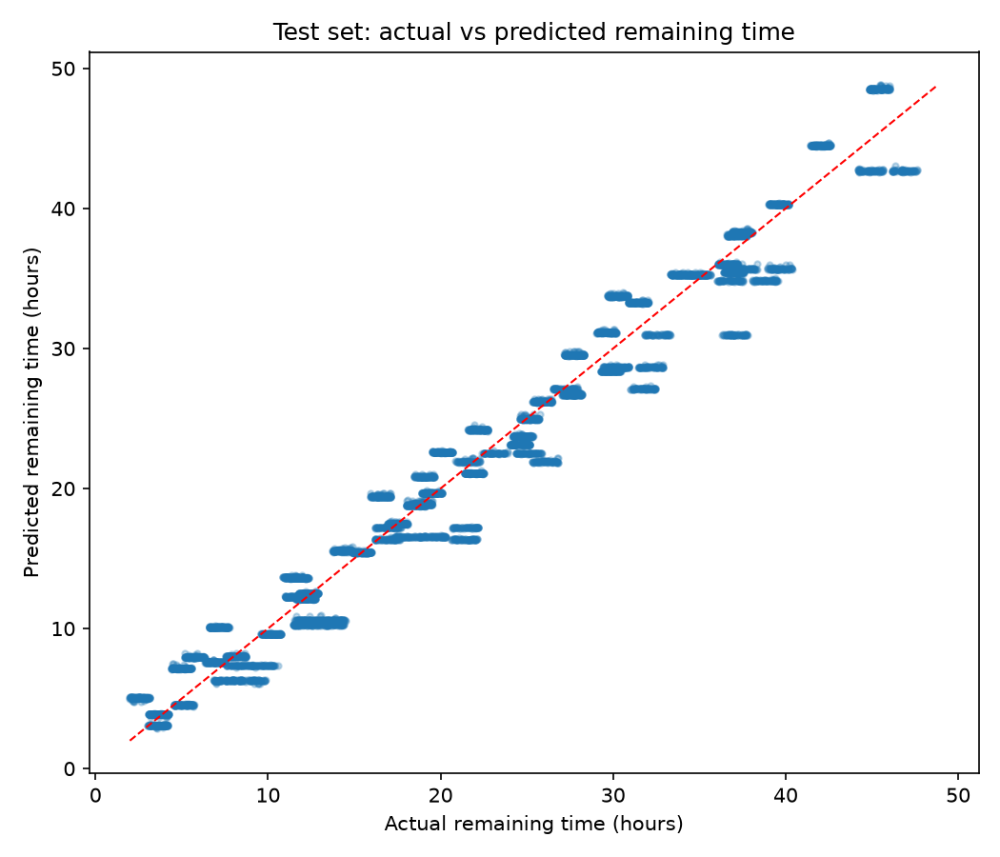
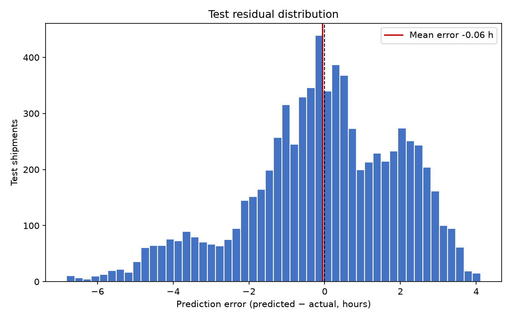
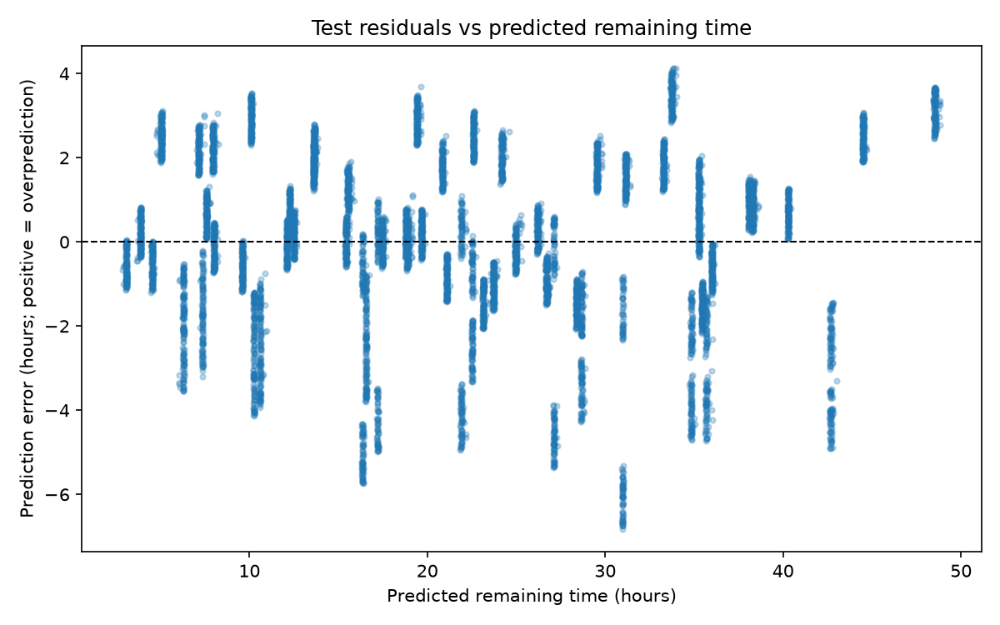

# ETA model interpretation and test error analysis

## Scope and integrity

This analysis reads the fitted Ridge pipeline at `models/eta_v1/ridge_pipeline.joblib` and its saved prediction file. No model fitting or selection was run. The saved artifact reproduced the saved test predictions with maximum absolute difference 7.1054273576e-15 hours.
The test set remains the original 7,500 shipment holdout; this analysis uses it only to describe errors after model selection. No source feature, target, or prediction files were edited.

## Reading Ridge coefficients

For numeric inputs, the pipeline standardizes each value, so a coefficient is the estimated change in remaining hours for a one-training-standard-deviation increase in that input, holding other inputs fixed. For one-hot categories, a coefficient is the contribution of that encoded category indicator in hours. Because the encoder keeps every category and Ridge regularizes coefficients, category values should be read as adjusted associations around the fitted intercept, not as a causal comparison against a single dropped reference category.
Correlated predictors make individual coefficients less stable: the route distance/hours and elapsed-time fields contain overlapping information. Therefore the ranking below is influence within this fitted model, not proof that a factor causes delay.

### 15 largest absolute coefficients

| Encoded feature | Type | Coefficient | Interpretation |
|---|---|---:|---|
| `numeric__remaining_scheduled_hours` | scaled numeric | +8.3555 | hours per one training-standard-deviation increase, other inputs held fixed |
| `numeric__planned_route_hours` | scaled numeric | +8.2379 | hours per one training-standard-deviation increase, other inputs held fixed |
| `numeric__remaining_scheduled_distance_km` | scaled numeric | -3.0885 | hours per one training-standard-deviation increase, other inputs held fixed |
| `numeric__planned_route_distance_km` | scaled numeric | -3.0885 | hours per one training-standard-deviation increase, other inputs held fixed |
| `categorical__shipment_priority_standard` | one-hot category | +1.8001 | hours contribution for this encoded category indicator, conditional on other inputs |
| `categorical__shipment_priority_low` | one-hot category | -1.0028 | hours contribution for this encoded category indicator, conditional on other inputs |
| `categorical__carrier_type_ftl` | one-hot category | -0.9411 | hours contribution for this encoded category indicator, conditional on other inputs |
| `categorical__shipment_priority_high` | one-hot category | -0.7974 | hours contribution for this encoded category indicator, conditional on other inputs |
| `numeric__queue_observation_count` | scaled numeric | +0.5401 | hours per one training-standard-deviation increase, other inputs held fixed |
| `categorical__service_mode_ftl` | one-hot category | +0.4670 | hours contribution for this encoded category indicator, conditional on other inputs |
| `categorical__carrier_type_last_mile` | one-hot category | -0.4477 | hours contribution for this encoded category indicator, conditional on other inputs |
| `numeric__remaining_scheduled_leg_count` | scaled numeric | +0.4156 | hours per one training-standard-deviation increase, other inputs held fixed |
| `numeric__planned_leg_count` | scaled numeric | +0.4156 | hours per one training-standard-deviation increase, other inputs held fixed |
| `categorical__service_mode_rail` | one-hot category | -0.4010 | hours contribution for this encoded category indicator, conditional on other inputs |
| `categorical__carrier_type_air` | one-hot category | +0.3846 | hours contribution for this encoded category indicator, conditional on other inputs |

Positive coefficients push the model toward more hours remaining; negative coefficients push it toward fewer hours, all else held fixed. Numeric coefficients are per standard deviation because the numeric pipeline scales inputs.

## Test residuals

Residual/error is defined as predicted minus actual remaining hours, so positive bias means the model predicts a later delivery than occurred (overprediction). Mean error is -0.0593 h, median error +0.0415 h, mean absolute error 1.6038 h, and median absolute error 1.3345 h.
Signed error percentiles (hours): P1 -5.389, P5 -4.054, P10 -2.981, P25 -1.185, P50 +0.042, P75 +1.491, P90 +2.502, P95 +2.927, P99 +3.543.
Absolute error percentiles (hours): P50 1.334, P75 2.356, P90 3.388, P95 4.069, P99 5.389; maximum absolute error 6.819 h. Largest overprediction +4.120 h; largest underprediction -6.819 h.

### Actual and predicted delivery-time examples

The CSV contains ten best and ten worst test predictions. Actual delivery time is from the separate target file; predicted delivery time is `predicted_at + predicted_remaining_hours`.
| Group | Shipment ID | Priority | Carrier | Mode | Actual delivery (UTC) | Predicted delivery (UTC) | Error (h) |
|---|---|---|---|---|---|---|---:|
| 10 lowest absolute errors | `SHP-2026-034544` | standard | air | ftl | 2026-09-30 03:12:36+00:00 | 2026-09-30 03:12:36.139077062+00:00 | +0.000 |
| 10 lowest absolute errors | `SHP-2026-026144` | standard | air | ftl | 2026-10-13 11:18:36+00:00 | 2026-10-13 11:18:35.200301137+00:00 | -0.000 |
| 10 lowest absolute errors | `SHP-2026-016156` | standard | ltl | rail | 2026-09-26 23:29:24+00:00 | 2026-09-26 23:29:21.218928643+00:00 | -0.001 |
| 10 lowest absolute errors | `SHP-2026-044007` | low | last_mile | ltl | 2026-10-27 00:11:12+00:00 | 2026-10-27 00:11:09.097046030+00:00 | -0.001 |
| 10 lowest absolute errors | `SHP-2026-010027` | low | last_mile | ftl | 2026-10-16 17:34:00+00:00 | 2026-10-16 17:33:56.780835838+00:00 | -0.001 |
| 10 lowest absolute errors | `SHP-2026-035366` | high | rail | rail | 2026-10-13 14:40:48+00:00 | 2026-10-13 14:40:44.026042839+00:00 | -0.001 |
| 10 lowest absolute errors | `SHP-2026-011716` | standard | ltl | rail | 2026-09-22 08:45:24+00:00 | 2026-09-22 08:45:19.384025745+00:00 | -0.001 |
| 10 lowest absolute errors | `SHP-2026-030122` | high | ltl | last_mile | 2026-10-10 15:51:00+00:00 | 2026-10-10 15:51:05.394509906+00:00 | +0.001 |
| 10 lowest absolute errors | `SHP-2026-018603` | low | ftl | ftl | 2026-09-24 22:13:24+00:00 | 2026-09-24 22:13:29.448299004+00:00 | +0.002 |
| 10 lowest absolute errors | `SHP-2026-024462` | high | ltl | ocean | 2026-10-09 10:02:00+00:00 | 2026-10-09 10:01:54.291270370+00:00 | -0.002 |
| 10 highest absolute errors | `SHP-2026-046912` | standard | ocean | last_mile | 2026-09-28 03:27:00+00:00 | 2026-09-27 20:37:51.955783334+00:00 | -6.819 |
| 10 highest absolute errors | `SHP-2026-012592` | standard | ocean | last_mile | 2026-10-15 13:45:00+00:00 | 2026-10-15 07:00:08.394265012+00:00 | -6.748 |
| 10 highest absolute errors | `SHP-2026-008992` | standard | ocean | last_mile | 2026-10-14 20:35:00+00:00 | 2026-10-14 13:50:10.610895944+00:00 | -6.747 |
| 10 highest absolute errors | `SHP-2026-048592` | standard | ocean | last_mile | 2026-09-30 21:18:00+00:00 | 2026-09-30 14:34:19.801962382+00:00 | -6.728 |
| 10 highest absolute errors | `SHP-2026-049432` | standard | ocean | last_mile | 2026-10-11 09:00:00+00:00 | 2026-10-11 02:17:03.867819367+00:00 | -6.716 |
| 10 highest absolute errors | `SHP-2026-011632` | standard | ocean | last_mile | 2026-09-15 08:27:00+00:00 | 2026-09-15 01:45:30.717483366+00:00 | -6.691 |
| 10 highest absolute errors | `SHP-2026-024472` | standard | ocean | last_mile | 2026-10-29 10:48:00+00:00 | 2026-10-29 04:08:08.818203302+00:00 | -6.664 |
| 10 highest absolute errors | `SHP-2026-006712` | standard | ocean | last_mile | 2026-10-28 08:28:00+00:00 | 2026-10-28 01:48:37.233938253+00:00 | -6.656 |
| 10 highest absolute errors | `SHP-2026-015232` | standard | ocean | last_mile | 2026-10-09 16:09:00+00:00 | 2026-10-09 09:29:43.160195036+00:00 | -6.655 |
| 10 highest absolute errors | `SHP-2026-017992` | standard | ocean | last_mile | 2026-10-16 11:14:00+00:00 | 2026-10-16 04:36:32.388509731+00:00 | -6.624 |

### Errors by operational group

#### Shipment priority

Positive mean error indicates overprediction. These are descriptive groups; small differences are not significance tests.

| Group | N | Mean error (h) | MAE (h) | Median absolute (h) | P90 absolute (h) | Within 1h | Within 2h | Within 4h |
|---|---:|---:|---:|---:|---:|---:|---:|---:|
| high | 1,878 | -0.039 | 0.731 | 0.612 | 1.506 | 71.0% | 96.7% | 100.0% |
| low | 1,840 | +0.002 | 0.730 | 0.609 | 1.497 | 69.2% | 99.1% | 100.0% |
| standard | 3,782 | -0.099 | 2.462 | 2.342 | 4.055 | 9.9% | 36.2% | 89.1% |

#### Carrier type

Positive mean error indicates overprediction. These are descriptive groups; small differences are not significance tests.

| Group | N | Mean error (h) | MAE (h) | Median absolute (h) | P90 absolute (h) | Within 1h | Within 2h | Within 4h |
|---|---:|---:|---:|---:|---:|---:|---:|---:|
| air | 1,160 | -0.081 | 1.316 | 1.020 | 2.927 | 48.4% | 79.0% | 96.2% |
| ftl | 1,090 | -0.062 | 1.315 | 1.349 | 2.090 | 28.8% | 86.1% | 100.0% |
| last_mile | 756 | -0.025 | 0.383 | 0.337 | 0.754 | 96.8% | 100.0% | 100.0% |
| ltl | 1,129 | -0.064 | 2.053 | 2.102 | 3.883 | 32.2% | 47.2% | 91.1% |
| ocean | 1,100 | -0.087 | 2.094 | 2.019 | 3.583 | 23.5% | 49.0% | 92.8% |
| parcel | 1,140 | +0.024 | 1.865 | 1.707 | 3.663 | 32.8% | 56.9% | 92.7% |
| rail | 1,125 | -0.110 | 1.806 | 1.592 | 3.870 | 33.6% | 60.4% | 90.8% |

#### Service mode

Positive mean error indicates overprediction. These are descriptive groups; small differences are not significance tests.

| Group | N | Mean error (h) | MAE (h) | Median absolute (h) | P90 absolute (h) | Within 1h | Within 2h | Within 4h |
|---|---:|---:|---:|---:|---:|---:|---:|---:|
| air | 968 | -0.054 | 1.492 | 1.182 | 3.242 | 41.1% | 72.4% | 96.4% |
| ftl | 1,100 | -0.113 | 1.095 | 0.598 | 2.687 | 66.5% | 80.8% | 93.7% |
| last_mile | 1,068 | -0.101 | 2.128 | 2.153 | 3.872 | 32.4% | 47.5% | 91.5% |
| ltl | 1,165 | +0.045 | 1.666 | 1.368 | 3.652 | 40.0% | 66.1% | 92.5% |
| ocean | 1,025 | -0.051 | 1.591 | 1.553 | 2.619 | 21.8% | 70.7% | 100.0% |
| parcel | 1,151 | -0.054 | 1.524 | 1.306 | 3.232 | 40.7% | 68.4% | 95.4% |
| rail | 1,023 | -0.094 | 1.740 | 1.593 | 3.227 | 33.9% | 61.7% | 92.6% |

#### Weather exposure (active disruption present at prediction)

Positive mean error indicates overprediction. These are descriptive groups; small differences are not significance tests.

| Group | N | Mean error (h) | MAE (h) | Median absolute (h) | P90 absolute (h) | Within 1h | Within 2h | Within 4h |
|---|---:|---:|---:|---:|---:|---:|---:|---:|
| active_disruption | 148 | +0.620 | 1.698 | 1.453 | 3.291 | 33.8% | 60.8% | 95.9% |
| no_active_disruption | 7,352 | -0.073 | 1.602 | 1.329 | 3.389 | 39.9% | 66.9% | 94.5% |

#### Remaining planned route distance quartile

Positive mean error indicates overprediction. These are descriptive groups; small differences are not significance tests.

| Group | N | Mean error (h) | MAE (h) | Median absolute (h) | P90 absolute (h) | Within 1h | Within 2h | Within 4h |
|---|---:|---:|---:|---:|---:|---:|---:|---:|
| Q1 shortest | 1,875 | +0.069 | 1.505 | 1.239 | 3.011 | 43.1% | 63.1% | 99.5% |
| Q2 | 1,875 | -0.176 | 1.472 | 0.885 | 3.651 | 52.4% | 68.7% | 91.9% |
| Q3 | 1,875 | +0.196 | 1.554 | 1.345 | 3.277 | 36.4% | 71.6% | 95.1% |
| Q4 longest | 1,875 | -0.326 | 1.884 | 1.546 | 3.788 | 27.0% | 63.8% | 91.5% |

### Systematic bias observations

- No category/distance/weather group with at least 100 test rows has an absolute mean signed error of one hour or more.

## Why performance may be unusually high

The generator code makes actual delivery time a deterministic operational construction with a small stable per-shipment random component: planned delivery plus a schedule variance, with fixed delay-minute mechanisms for delay reasons. It creates route duration and ETA time from the same planned route schedule. The feature builder derives remaining scheduled hours/distance, route duration, and journey elapsed time from that schedule. Consequently, those predictors closely reconstruct the target's planned-time component; this is a synthetic-data relationship rather than evidence of real-world causal or predictive strength.
The target itself is computed in `src/features/point_in_time.py` as actual delivery time minus predicted_at and is kept separate from predictors. No target or audit fields were supplied to the model. Even without direct leakage, generator construction can make the task much easier than real operations. The model should be tested on independent, real historical shipments before operational use.

## Practical error thresholds to consider

No business SLA or dispatch decision threshold was supplied, so these are evaluation bands, not requirements: within 1 hour could support near-term ETA confidence; 2 hours may be a useful planning band; 4 hours may suit broader customer communication; above 4 hours could trigger a manual review or lower confidence. The saved group tables show the observed share of test rows within each band. Thresholds should be selected with operations teams based on decisions, costs, and customer promises.

## Figures

- 
- 
- 

## Source logic inspected

- `src/generator/generate.py`: constructs planned and actual delivery timestamps, schedule variance, delivery events, and ETA snapshots.
- `src/features/point_in_time.py`: builds predictor values at the ETA cutoff and separately derives `target_remaining_hours` from actual delivery.
- `reports/modeling/eta_v1/preprocessing_config.json`: documents the actual fitted predictor set and transformations.
